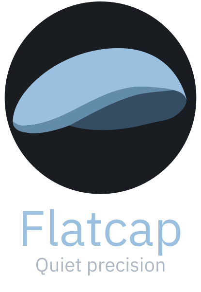
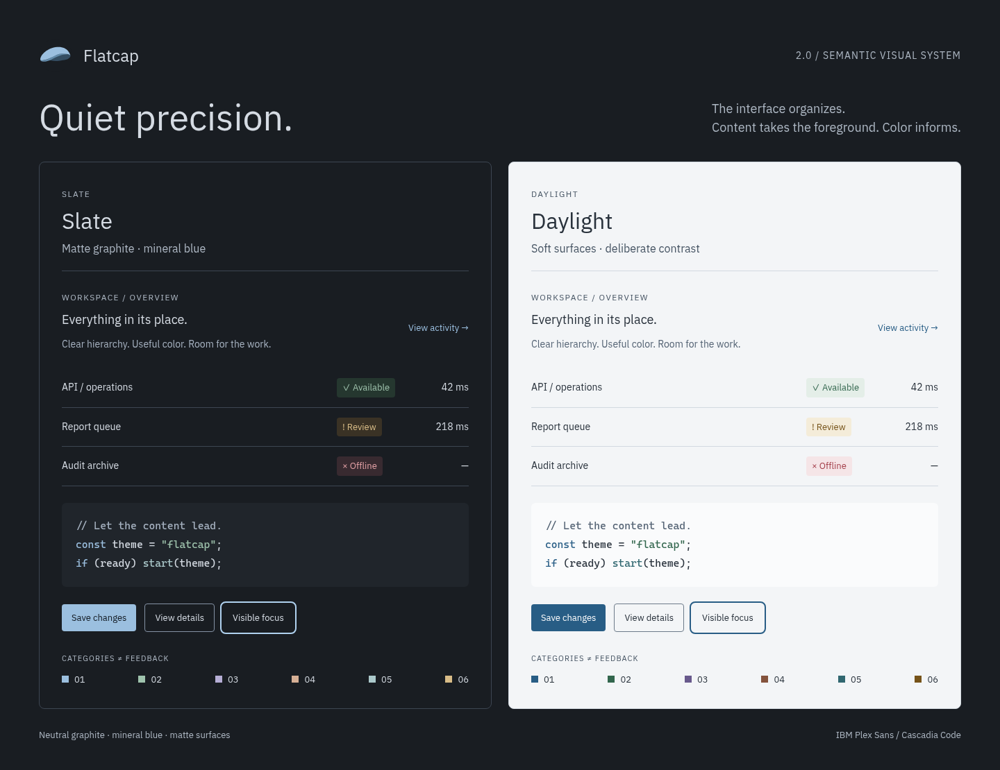
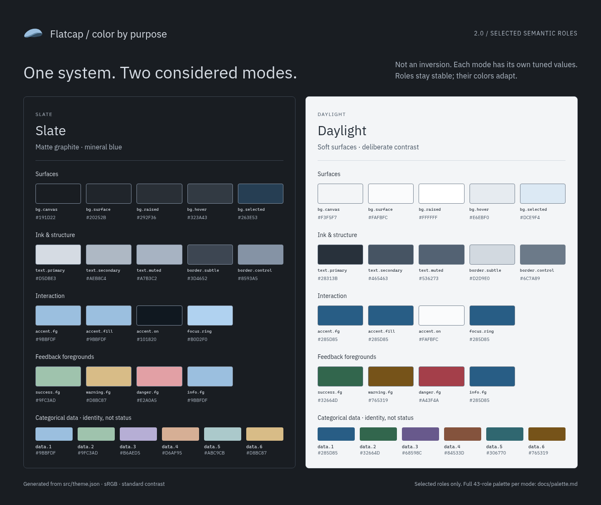
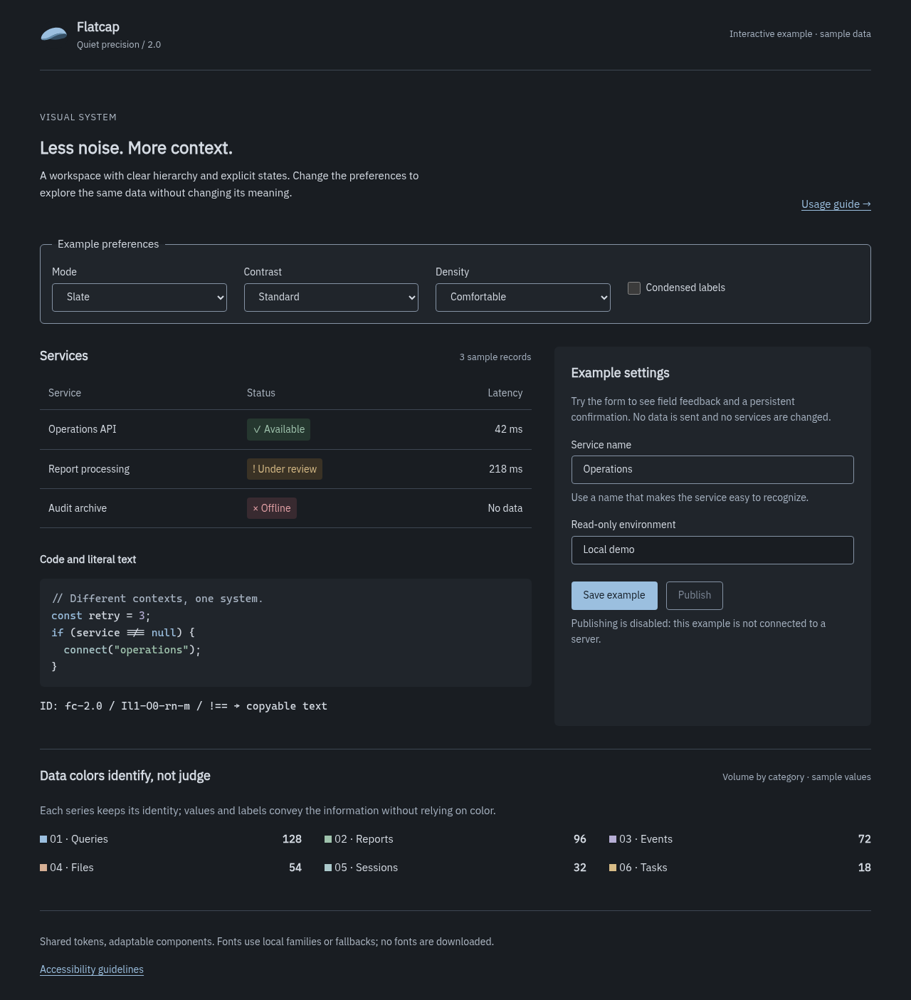
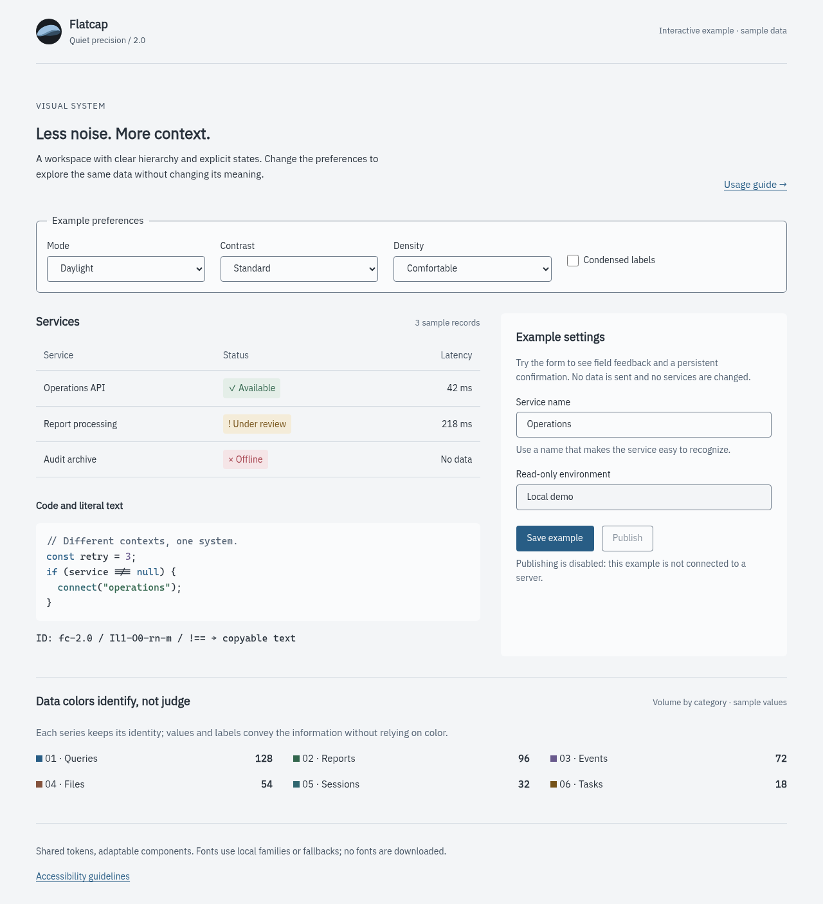

# Flatcap — Quiet precision

<p align="center"></p>

**Flatcap is a semantic visual system for focused work:** application interfaces, code, documentation and data-dense dashboards. Matte graphite, mineral blue, IBM Plex and Cascadia; two independently tuned modes, **Slate** and **Daylight**.

> The interface organizes. Content takes the foreground. Color informs.

This is the **core of Flatcap**: the shared colors, typography, design principles and tokens that give Flatcap-based projects a consistent visual language. Use it as a foundation for a new interface or adapt it to the tools you already work with.

## Integrations

Flatcap 2.0 is ready to install in these applications. Each one is generated from the same `src/theme.json`.

| App | Install | Modes |
| :--- | :--- | :--- |
| [Obsidian](https://github.com/cheycron/flatcap-obsidian) | Community themes: search for **FlatCap** ([directory](https://community.obsidian.md/themes/flatcap)) | Slate and Daylight follow Obsidian's base color scheme. |
| [VS Code](https://github.com/cheycron/flatcap-vscode) | [Visual Studio Marketplace](https://marketplace.visualstudio.com/items?itemName=cheycron.flatcap-theme) | Flatcap Slate and Flatcap Daylight, with optional automatic switching. |
| [Windows Terminal](https://github.com/cheycron/flatcap-windows-terminal) | Repository: JSON fragment or paste into `settings.json` | Two color schemes and window themes; automatic mode in `settings.json`. |
| [FreshRSS](https://github.com/cheycron/flatcap-freshrss) | Repository: paste into the User CSS extension | Slate, Daylight, or a stylesheet that follows the system. |
| [Firefox](https://github.com/cheycron/flatcap-firefox) | [Firefox Add-ons](https://addons.mozilla.org/firefox/addon/flatcap/) | Follows the operating system's light or dark setting. |
| [Stylus](https://github.com/cheycron/flatcap-userstyles) | Repository: UserCSS styles for Gemini, Gmail, Instagram and Reddit | Follow system, Slate or Daylight per style. |
| [OpenClaw](https://github.com/cheycron/flatcap-openclaw) | ClawHub: `openclaw plugins install clawhub:@cheycron/flatcap-openclaw` | Follows the Control UI color mode. |
| [Home Assistant](https://github.com/cheycron/flatcap-homeassistant) | HACS: custom repository, category **Theme** | Flatcap follows the profile's light or dark mode; Flatcap Slate and Flatcap Daylight pin one. |
| [Gitea](https://github.com/cheycron/flatcap-gitea) | Repository: copy the CSS to `public/assets/css/` and list it in `[ui] THEMES` | Flatcap (auto) follows the system; Flatcap Slate and Flatcap Daylight pin one. |
| [Jellyfin](https://github.com/cheycron/flatcap-jellyfin) | Repository: paste one CSS into Dashboard → Branding → Custom CSS (base theme **Dark**) | Slate, Daylight, or a stylesheet that follows the system; Flatcap TV is a minimal TV-first dark variant. |

## Flatcap at a glance



**Quiet precision** means hierarchy before decoration: neutral surfaces organize the workspace, mineral blue identifies interaction, and feedback combines color with words and symbols. Content stays in the foreground; the interface provides structure without competing for attention.

### Two modes, one visual language

- **Slate:** matte graphite surfaces, light text and a restrained mineral-blue accent.
- **Daylight:** soft light surfaces, dark text and the same hierarchy expressed with independently tuned colors.

The modes share semantic roles, not identical values. Daylight is not an inversion of Slate. Contrast and spacing density are independent preferences, so the interface can adapt without changing its identity.

### Color by purpose



Colors are named for **what they do**: surfaces, text, borders, interaction, feedback, syntax and data. Each mode provides **43 color roles**. A shared hex value does not make two roles interchangeable.

Mineral blue identifies interaction. Feedback colors express status alongside labels and symbols. The six categorical data colors identify series independently of success, warning or error.

[Explore the complete palette and tokens →](docs/palette.md)

## Design principles

- **Hierarchy before decoration.** Organize through spacing, alignment, typography and clear headings.
- **Useful color.** Keep surfaces and ordinary metrics neutral; reserve color for actions, states and meaningful distinctions.
- **Matte, deliberate geometry.** Use a 4px spacing grid, subtle separators and modest corner radii. Elevation comes from surface and border; shadows belong to overlays.
- **Density without smaller text.** Comfortable and Compact adjust spacing, not the type scale. Condensed labels are a separate choice.
- **Explicit interaction.** Give focus, selection, feedback and errors distinct signals. Meaning should not depend on color alone.
- **User control.** Support light and dark preferences, increased contrast, scalable text and reduced motion.

No decorative glow, glass, blur or noisy backgrounds. The visual language should make room for the work.

[Read the design system →](docs/design-system.md)

## Typography

- **IBM Plex Sans:** interfaces, navigation and reading.
- **IBM Plex Sans Condensed:** optional short labels in dense lists, trees and tables.
- **Cascadia Code:** editable code, with user-adjustable contextual ligatures.
- **Cascadia Mono**, or ligatures disabled: logs, hashes and literal identifiers.

Start with 16px for reading, 15px for application text and code, and 14px for controls and tables. Use regular and medium weights for everyday content, with semibold headings. Keep text scalable and let layouts grow with it.

Fonts are not bundled. Use the appropriate licensed font files or the provided fallback stacks. Nerd Font variants are an option for terminals that need their additional symbols, not a requirement for interfaces.

[Typography, scale and font usage →](docs/typography.md)

## Motion

**Fast, fluid, and quietly precise.** Motion should make an interface feel responsive and dependable: acknowledge actions immediately, explain changes, and then get out of the way. Modern does not mean theatrical; the content and the user's task remain the focus.

- **Respond without waiting.** Pressed states and keyboard focus appear immediately. Animation never delays an action or hides real loading time.
- **Keep transitions short.** Use roughly 100–140ms for small state changes and 160–220ms for panels and dialogs. Exits are no slower than entrances; most routine transitions finish within 250ms.
- **Move less, connect more.** Use gentle deceleration, subtle opacity changes, and short 4–8px movements only when they explain a relationship. No bounce, overshoot, decorative zoom, or cascading reveals on routine screens.
- **Stay smooth and interruptible.** Prefer `opacity` and `transform` where appropriate, preserve layout and focus, and respond to a new action without queuing animations.
- **Respect motion preferences.** With reduced motion, remove nonessential movement and show the final state directly. Never animate the entire interface when changing themes.

The shared `motion.fast` token is **120ms**; longer component timings are guidance, not additional exported tokens. Perceived responsiveness must reflect real feedback, not artificial progress or a promise of faster processing.

[Motion principles, timing, easing, and implementation →](docs/motion.md)

## In an interface

The [interactive example](examples/index.html) shows the visual language in tables, forms, code and categorical data. Click a preview to inspect it at full size.

| Slate | Daylight |
| --- | --- |
| [](images/readme/example-slate.png) | [](images/readme/example-daylight.png) |

[Mobile preview · 375px](images/readme/example-mobile.png)

## Build with Flatcap

Use the shared tokens as the visual foundation of your project, then map them to its components and interaction patterns.

| Resource | Purpose |
| --- | --- |
| [`src/theme.json`](src/theme.json) | Canonical colors, typography, spacing, density and brand roles. |
| [`src/theme.css`](src/theme.css) | CSS custom properties for web interfaces. |
| [`src/theme.scss`](src/theme.scss) | Sass maps, functions and an opt-in token mixin. |
| [`src/logo.svg`](src/logo.svg) | Vector brand symbol. |
| [`examples/`](examples/index.html) | A working example of the tokens in context. |

### Start with CSS

Import `src/theme.css` and choose preferences on the document root:

```html
<html lang="en" data-fc-theme="slate" data-fc-contrast="standard"
      data-fc-density="comfortable">
```

```css
@import "./src/theme.css";

body {
  background: var(--fc-bg-canvas);
  color: var(--fc-text-primary);
  color-scheme: var(--fc-color-scheme);
  font: var(--fc-font-size-body)/var(--fc-font-line-body) var(--fc-font-ui);
}
```

Slate, standard contrast and comfortable spacing are the defaults. Set `data-fc-theme="system"` or `data-fc-contrast="system"` to follow supported system preferences. Choose `daylight`, `more` or `compact` explicitly when appropriate.

The stylesheet supplies tokens; your project supplies its layout and components. Sass offers `color()`, `value()` and the opt-in `tokens()` mixin. To customize the core, edit `src/theme.json` and run `python3 scripts/build.py` with Python 3.10+ to regenerate its exports.

[CSS/Sass API and usage guide →](docs/usage.md)

## Reference

- [Design system](docs/design-system.md)
- [Complete palette and tokens](docs/palette.md)
- [Typography](docs/typography.md)
- [Motion](docs/motion.md)
- [Usage and CSS/Sass API](docs/usage.md)
- [Accessibility guidelines](docs/accessibility.md)
- [Brand assets and attribution](docs/branding.md)
- [Portable agent skill](SKILL.md)

## License

Code and tokens are available under the [MIT License](LICENSE). Pre-existing artwork retains its attribution and original reuse terms. Font licenses are separate. See the [brand guide](docs/branding.md) for asset usage.
